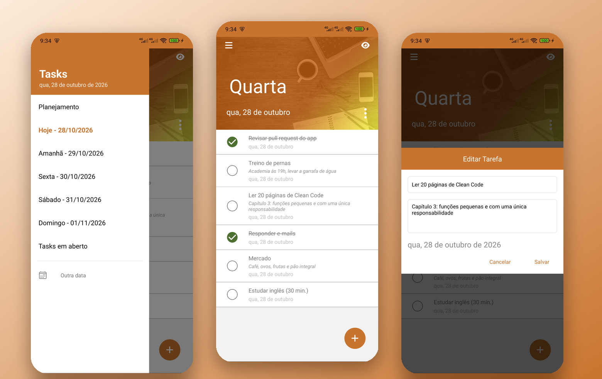
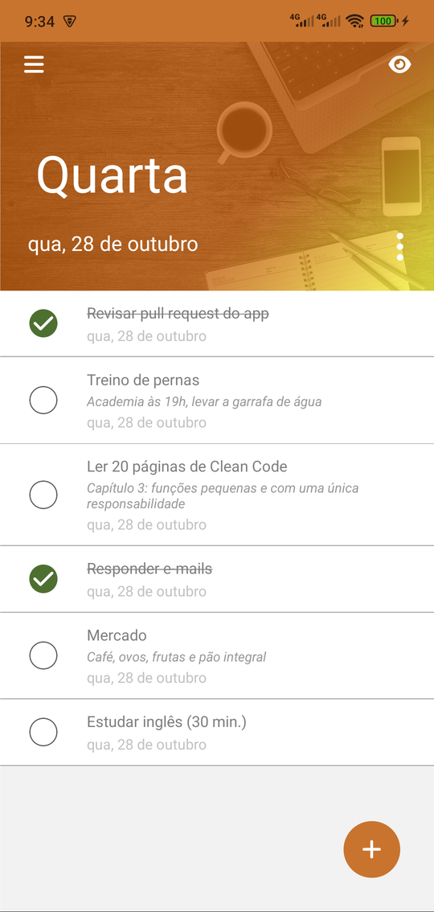
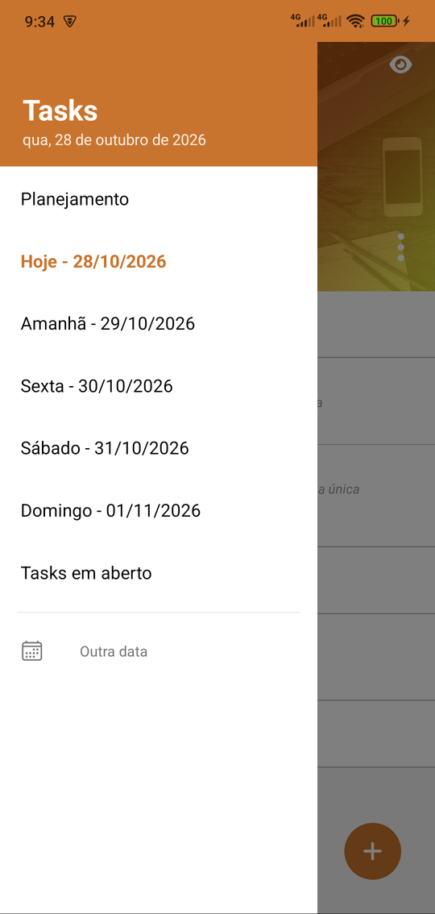
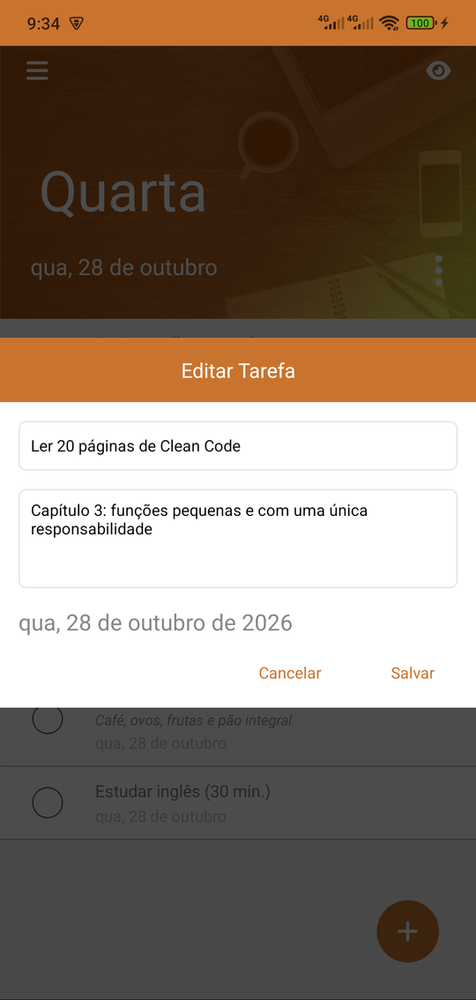
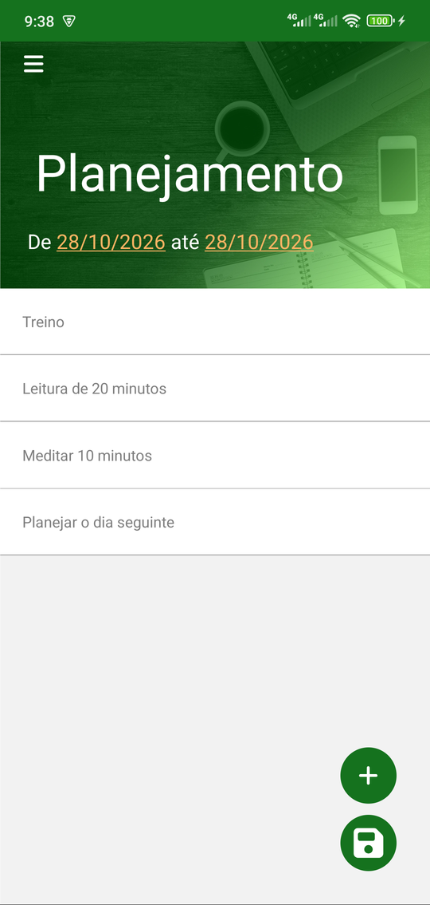
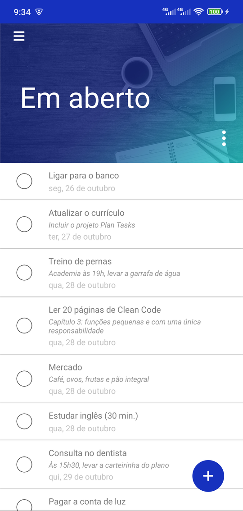
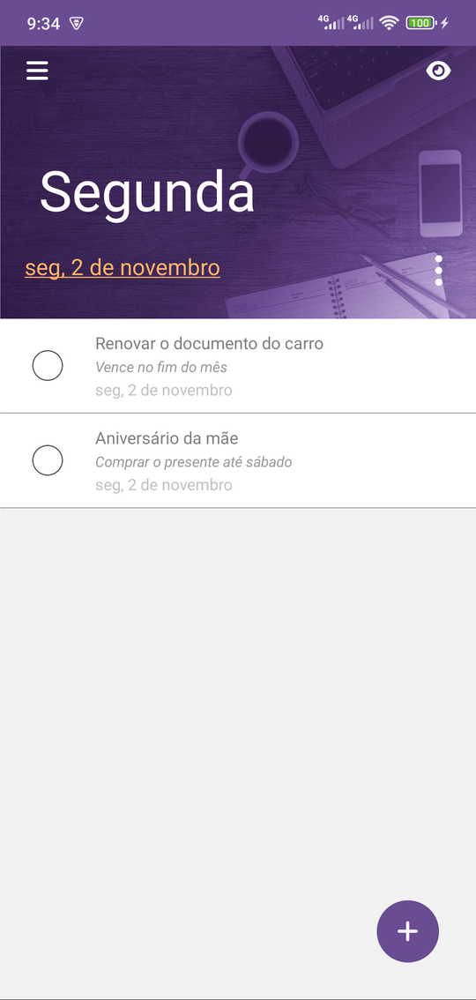
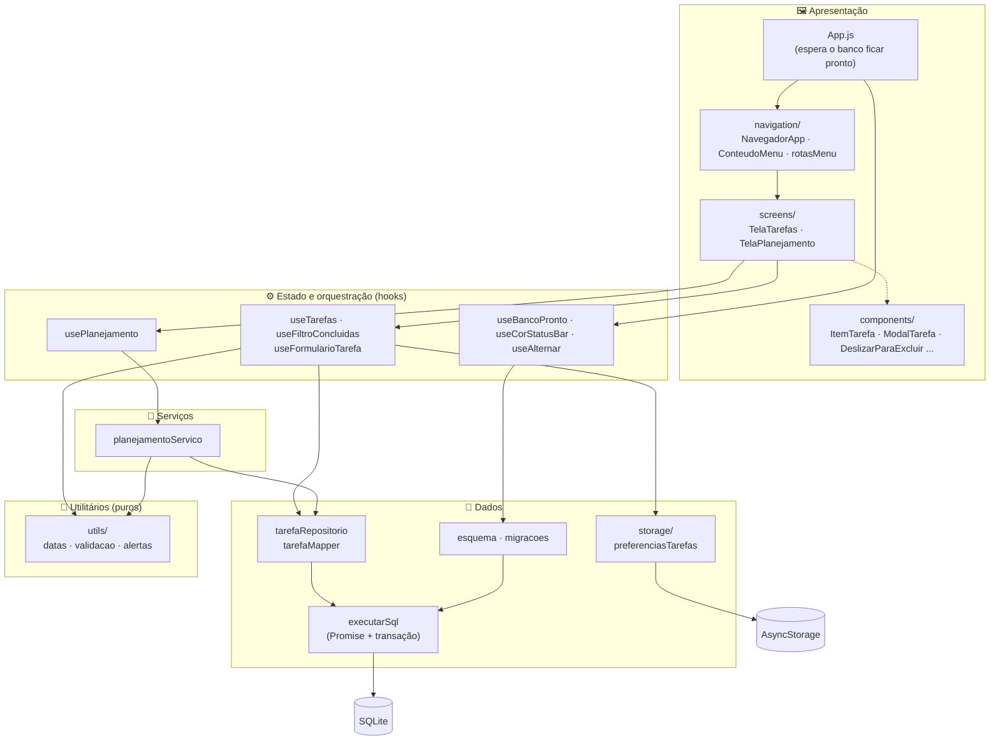
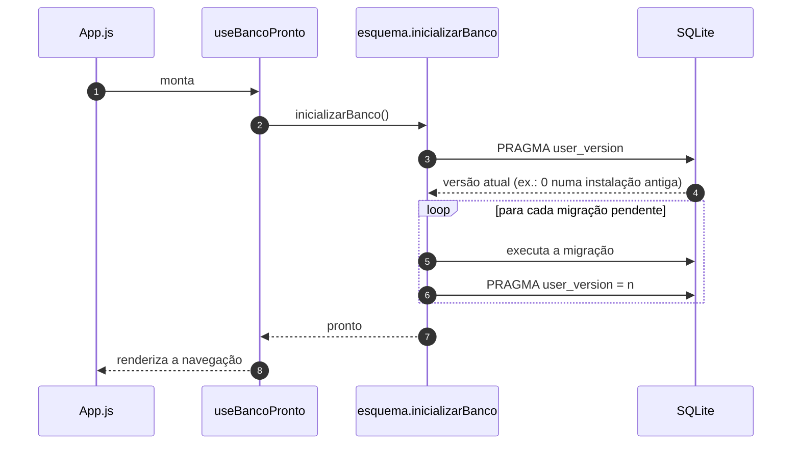

<p align="center">
  
</p>

<p align="center">
  <a href="https://github.com/unifkaraujo/plan-tasks/actions/workflows/ci.yml"></a>
  
  
  
  
  
  
  
  <a href="LICENSE"></a>
</p>

<p align="center">
  <a href="#-funcionalidades">Funcionalidades</a> •
  <a href="#-telas">Telas</a> •
  <a href="#-stack">Stack</a> •
  <a href="#️-arquitetura">Arquitetura</a> •
  <a href="#️-dados-e-persistência">Dados</a> •
  <a href="#-decisões-técnicas">Decisões técnicas</a> •
  <a href="#-testes-e-qualidade">Testes</a> •
  <a href="#-como-rodar">Como rodar</a>
</p>

---

O **Plan Tasks** é um app Android de tarefas do dia a dia, **100% offline e sem cadastro**. Ele junta duas ideias: **planejar** uma rotina uma única vez e replicá-la por um período inteiro, e **acompanhar** o dia com o mínimo de toques (hoje, os próximos dias e o que ficou em aberto).

O projeto começou em 2024 como uma ferramenta pessoal, escrita com componentes de classe e toda a lógica dentro das telas. Em 2026 ele foi reescrito com **componentes funcionais e hooks**, **arquitetura em camadas**, **migrações versionadas** do banco, **operações em lote**, **testes automatizados** e **CI**, sem perder os dados de quem já usava o app.

<p align="center">
  
</p>

## ✨ Funcionalidades

- 🗓️ **Visão por dia:** Hoje, Amanhã e os três dias seguintes, cada um com o nome do dia da semana e a sua própria cor de tema.
- 📋 **Planejamento em lote:** monte uma lista de tarefas, escolha o período (_de_ / _até_) e o app grava cada tarefa em todos os dias, numa única transação.
- ⏳ **Tasks em aberto:** tudo o que ainda não foi concluído, de qualquer data, ordenado pela data prevista.
- 📅 **Outra data:** um atalho discreto no rodapé do menu para ver e gerenciar qualquer dia além dos cinco primeiros, sem poluir a navegação principal.
- ✏️ **Criar e editar** com descrição, observação e data. Um toque no texto abre a edição, e um toque no círculo conclui a tarefa.
- 🧹 **Ações em massa** pelo menu ⋮: marcar, desmarcar ou excluir todas as tarefas visíveis, com confirmação antes de excluir.
- 👆 **Deslizar para excluir**, com a dica visual "Excluir" durante o gesto.
- 👁️ **Ocultar concluídas**, com a preferência lembrada entre aberturas do app.
- 📴 **Offline e privado:** os dados ficam só no SQLite do aparelho, sem servidor nem conta.

## 📱 Telas

| Hoje | Menu | Edição |
|:---:|:---:|:---:|
|  |  |  |
| **Planejamento** | **Em aberto** | **Outra data** |
|  |  |  |

> Os prints foram feitos num Android real, numa cópia do app instalada com outro ID (`com.tasks.demo`) e carregada com dados fictícios.

## 🧰 Stack

| Camada | Tecnologia | Para que serve |
|---|---|---|
| UI | **React Native 0.73** + **React 18.2** | Interface nativa com componentes funcionais e hooks |
| Navegação | **React Navigation 6** (Drawer) | Menu lateral gerado a partir de uma lista de rotas |
| Banco de dados | **react-native-sqlite-storage 6** (SQLite) | Tarefas persistidas no aparelho, com índices e migrações |
| Preferências | **AsyncStorage** | Guarda a opção "mostrar concluídas" entre aberturas |
| Datas | **Moment.js** (locale `pt-br`) | Formatação ("qua, 28 de outubro"), soma de dias e períodos |
| Gestos | **react-native-gesture-handler** (`Swipeable`) + **Reanimated 3** | Deslizar para excluir e animação do menu lateral |
| Ícones | **FontAwesome 6** + **Ionicons** | Ícones registrados uma única vez na inicialização |
| Feedback | **react-native-toast-message** | Confirmação discreta ao salvar um planejamento |
| Motor JS | **Hermes** | Inicialização mais rápida e menor consumo de memória no Android |
| Qualidade | **ESLint** (`@react-native`) + **Prettier** | Padronização e análise estática |
| Testes | **Jest 29** | Regras de datas, SQL gerado, migrações e serviço de planejamento |
| CI | **GitHub Actions** | Lint, formatação e testes a cada push |

## 🏛️ Arquitetura

O código está organizado em **camadas com dependências num sentido só**. As telas não conhecem SQL, os componentes não conhecem o banco e as regras de data são funções puras.



| Camada | Pasta | Responsabilidade |
|---|---|---|
| Apresentação | `screens/`, `components/`, `navigation/` | Renderizar e repassar eventos. Os componentes recebem dados e callbacks (`aoSalvar`, `aoExcluir`) por props e não têm regra de negócio |
| Estado | `hooks/`, `screens/*/use*.js` | Guardar estado, reagir ao foco da tela e orquestrar repositório e serviços. Fazem o papel de *containers* do padrão container/presentational |
| Serviços | `services/` | Regras que combinam mais de uma operação, como replicar o planejamento em um período |
| Dados | `database/`, `storage/` | Todo o SQL do app, as migrações e o AsyncStorage. Só esta camada sabe que existe SQLite |
| Utilitários | `utils/`, `theme/`, `config/` | Funções puras de data e validação, paleta de cores, imagens e registro de ícones |

### Estrutura de pastas

```text
src/
├── App.js                 # inicializa ícones, banco (migrações) e a status bar
├── components/
│   ├── common/            # BannerCabecalho, BotaoFlutuante, CampoData, CampoTexto, ModalFormulario, DeslizarParaExcluir...
│   └── tasks/             # ItemTarefa, MarcadorTarefa, ModalTarefa, ModalOpcoesTarefas, ItemTarefaPlanejamento...
├── config/                # icones (registro do FontAwesome)
├── database/              # conexao, executarSql, esquema, migracoes, tarefaRepositorio, tarefaMapper (+ testes)
├── hooks/                 # useBancoPronto, useCorStatusBar, useAlternar
├── navigation/            # NavegadorApp (drawer), ConteudoMenu, CabecalhoMenu, rotasMenu
├── screens/
│   ├── TaskList/          # TelaTarefas, CabecalhoTarefas, useTarefas, useFiltroConcluidas, useFormularioTarefa
│   └── Plan/              # TelaPlanejamento, CabecalhoPlanejamento, usePlanejamento
├── services/              # planejamentoServico (+ teste)
├── storage/               # armazenamentoJson, preferenciasTarefas
├── theme/                 # cores, fontes, imagens
└── utils/                 # datas, validacao, alertas (+ testes)
```

Cada tela é um módulo com a sua tela, os seus pedaços de interface e os hooks que guardam a lógica dela. O que é genérico sobe para `src/components` e `src/hooks`.

## 🗄️ Dados e persistência

### Modelo

A tabela mantém os nomes de colunas da primeira versão do app, para que as instalações existentes continuem funcionando. O `tarefaMapper` traduz cada linha para o modelo usado no resto do código:

| Coluna (`tasks`) | Tipo | Campo no app | Observação |
|---|---|---|---|
| `sequencia` | `INTEGER PK AUTOINCREMENT` | `id` | |
| `descricao` | `varchar(100)` | `descricao` | |
| `dataestimada` | `date` (`YYYY-MM-DD`) | `dataEstimada` | Indexada: filtro de cada dia |
| `datafim` | `date` (`YYYY-MM-DD`) | `dataConclusao` | Indexada: `NULL` = em aberto |
| `obs` | `varchar(200)` | `observacao` | Opcional |

### Migrações versionadas

A versão do esquema fica no próprio arquivo do banco (`PRAGMA user_version`). Na abertura, o app roda só as migrações que faltam, e as telas só são montadas depois disso:



| Versão | Migração | Por quê |
|---|---|---|
| 1 | `criarTabelaTarefas` | `CREATE TABLE IF NOT EXISTS`, seguro para quem já tinha a tabela |
| 2 | `garantirColunaObservacao` | Instalações muito antigas não tinham `obs`. Consulta `PRAGMA table_info` antes do `ALTER TABLE` |
| 3 | `criarIndicesDeData` | Índices em `dataestimada` e `datafim`, usados pelas consultas de cada tela |

### Operações em lote

Na versão original, "Deletar todos" fazia um `DELETE` por tarefa e recarregava a lista a cada uma, o que deixava o processo lento e visível. Hoje cada ação em massa é **um único comando**:

```sql
DELETE FROM tasks WHERE sequencia IN (?, ?, ?);
UPDATE tasks SET datafim = ? WHERE sequencia IN (?, ?);
```

O planejamento monta todas as linhas (tarefas × dias do período) em memória e grava tudo numa **única transação** (`executarEmTransacao`), recarregando a lista uma vez só.

## 🧠 Decisões técnicas

- **Hooks como containers.** Estado, efeitos e acesso a dados vivem em hooks como `useTarefas` e `usePlanejamento`. Os componentes ficam declarativos e podem mudar de visual sem tocar na lógica.
- **Banco pronto antes da primeira tela.** `useBancoPronto` segura a navegação até as migrações terminarem. Sem isso, numa instalação nova, a primeira consulta podia chegar antes do `CREATE TABLE`.
- **Datas como texto ISO (`YYYY-MM-DD`).** Comparação e ordenação funcionam direto no SQL, com índice. Na volta, a conversão usa `moment(texto, formato)` em hora local, porque `new Date('2026-10-28')` interpreta a data como UTC e, no Brasil (UTC−3), vira o dia anterior. Há um teste cobrindo esse caso.
- **Estado derivado em vez de sincronizado.** A data de cada tela é recalculada a cada renderização a partir de `diasAFrente`. Se o app ficar aberto depois da meia-noite, "Hoje" muda sozinho, sem timers. A lista visível (com ou sem concluídas) é derivada com `useMemo`.
- **Rotas como dados.** `rotasMenu.js` é uma lista com nome, rótulo, cor, imagem e parâmetros. O drawer e os itens do menu são gerados a partir dela, e a flag `secundaria` separa visualmente o atalho "Outra data". Adicionar um dia ao menu é adicionar um item na lista.
- **Uma tela, vários modos.** `TelaTarefas` atende a um dia fixo, às tarefas em aberto e a uma data escolhida, apenas pelos parâmetros da rota.
- **Modal montado sob demanda.** O modal de tarefa só existe enquanto está aberto e inicia o estado a partir das props. Isso dispensa o `useEffect` de "resetar o formulário" e garante que a edição sempre abre com os dados da tarefa certa.
- **Compatibilidade com quem já usava o app.** O mesmo `applicationId`, as mesmas chaves do AsyncStorage e os mesmos nomes de colunas foram mantidos na reescrita. A tradução para nomes novos acontece só no mapper.
- **Clean code.** Funções pequenas e com uma responsabilidade, nenhum comentário (os nomes explicam o código), estilos com `StyleSheet` e cores centralizadas em `theme/cores.js`.
- **Domínio em português.** Identificadores no idioma do domínio (`buscarTarefasPorData`, `ItemTarefa`, `aoExcluir`) e pastas no padrão do ecossistema (`components`, `hooks`, `screens`).

<details>
<summary><b>Bugs corrigidos durante a reescrita</b></summary>

- Excluir uma tarefa no Planejamento não fazia nada: a função só escrevia no console.
- A preferência "mostrar concluídas" era lida com o nome errado (`showDoneTask`) e nunca era lembrada.
- Cancelar o seletor de data no Android deixava a data da tarefa vazia.
- Uma nova tarefa criada na tela de Amanhã vinha com a data de hoje. Agora ela usa a data da tela.
- A observação era um campo de texto solto, que gravava no banco a cada tecla e quebrava o layout com textos longos.

</details>

## 🧪 Testes e qualidade

Os testes cobrem as partes que não dependem de tela e onde um erro custa caro (datas e SQL):

| Suíte | O que garante |
|---|---|
| `utils/datas.test.js` | Períodos inclusivos, nomes dos dias sem "-feira" e conversão de datas sem deslocamento de fuso |
| `utils/validacao.test.js` | Descrições vazias ou só com espaços são rejeitadas |
| `database/tarefaMapper.test.js` | Tradução das colunas legadas para o modelo do app |
| `database/tarefaRepositorio.test.js` | Ações em massa geram um único `IN (?, ?, ...)`, com os parâmetros na ordem certa, e lista vazia não toca no banco |
| `database/esquema.test.js` | Só as migrações pendentes rodam, e a versão é gravada depois de cada uma |
| `services/planejamentoServico.test.js` | Cada tarefa é replicada em todos os dias do período, numa única gravação |

```bash
npm test               # Jest
npm run lint           # ESLint
npm run format:check   # Prettier
```

O mesmo conjunto roda no **GitHub Actions** a cada push e pull request (`.github/workflows/ci.yml`).

## 🚀 Como rodar

### Pré-requisitos

- Node.js 18+ (o CI usa o 22)
- JDK 17 e Android SDK ([guia oficial do React Native](https://reactnative.dev/docs/environment-setup))
- Um aparelho Android com depuração USB ativa ou um emulador

### Desenvolvimento

```bash
git clone https://github.com/unifkaraujo/plan-tasks.git
cd plan-tasks
npm install

npm start            # terminal 1: Metro bundler
npm run android      # terminal 2: compila e instala no aparelho
```

### APK de release (sem depender do computador)

```bash
npx react-native run-android --mode=release
# ou, direto pelo Gradle:
cd android && ./gradlew app:installRelease
```

O APK fica em `android/app/build/outputs/apk/release/app-release.apk`.

## 🗺️ Próximos passos

- [ ] Testes dos hooks com React Native Testing Library
- [ ] Tarefas recorrentes (repetir toda semana sem precisar planejar)
- [ ] Notificação local com o resumo do dia
- [ ] Exportar e importar backup do banco
- [ ] Migração para TypeScript
- [ ] Keystore própria para o build de release (hoje assinado com a chave de debug do template)
- [ ] Carregar a fonte Lato no Android (o `react-native.config.js` aponta para uma pasta que não existe)

## 📄 Licença

[MIT](LICENSE) © Kaique Araujo

---

<p align="center">
  Feito por <a href="https://github.com/unifkaraujo"><b>Kaique</b></a>
</p>
